# FreeCoolGamesforMath.com · Rocket Builder

Build a rocket from parts, launch it, and do the math to reach orbit.
A free, school-safe browser game made for Chromebooks: **no ads, no accounts, no chat, no tracking**.
Progress and rocket designs are saved only in the browser (`localStorage`).

**Play:** https://kampfguy.github.io/FreeCoolGamesforMath/ (https://FreeCoolGamesforMath.com once the domain is registered and DNS is set up, see below)

## What's in it
- **Hangar:** snap-build from 19 original parts (capsule, probe core, parachute, 3 tanks, 3 engines, 2 solid boosters, 2 nose cones, fairing, stage separator, side boosters, fins, struts, legs). Drag and drop or tap to add.
  Live math panel: cost vs budget, mass, per-stage **Δv**, **TWR**, burn time, total Δv vs. the ~2,300 m/s needed for orbit, wobble/strut check.
- **Flight:** launch pad, throttle, steering, staging (dropped stages fall away), fuel burn, drag, parachutes, crash or soft landing,
  2D orbital physics around the small planet *Numeria*. Map view shows your path with **Ap/Pe** (high and low points).
  The HUD compares your *sideways speed* to the *circle speed* √(μ/r) needed to stay in orbit.
- **Missions:** First Hop (5 km), Edge of Space (30 km), Make an Orbit, Round Trip (space + soft landing), Moon Flyby (enter Lumo's SOI), Moon Landing, Moon and Back, Escape (orbit the star Ember), Free Flight. Up to 3 stars each (goal, under budget, bonus).
- **Solar system (patched conics):** the star **Ember**, planet **Numeria** (R 300 km, 30 km of air) and its moon **Lumo** (R 80 km, 1.6 m/s², no air, orbit 3,000 km, period ≈ 9.7 h). Each body has a sphere of influence r = a·(m/M)^(2/5) (Lumo ≈ 505 km, Numeria ≈ 11,900 km); the rocket only feels the body whose SOI it is in, and its state is converted when it crosses. Map view shows SOIs, the predicted path and an *Encounter: Lumo* marker.
- **Landing Legs** (radial part, G to deploy): safe touchdowns up to 12 m/s down, 5 m/s sideways, 15° tilt.
- **Boosters & aero (v boost1):**
  - **Solid Rocket Boosters**: Small SRB (0.35 t dry + 1.6 t fuel, 150 kN, Isp 200/230 s, 130 cr) and Large SRB (0.8 t + 4.5 t, 360 kN, 260 cr). Fuel built in; once lit they burn at full power until empty (throttle ignored, no shut-off). HUD row *SRB burn* shows seconds left.
  - **Side Boosters** (radial decoupler pair, 0.08 t, 80 cr): drop on a core part, then pick the booster in the right panel: body (Small/Large SRB or a tank), engine (tanks only) and an optional nose cone. They ignite with Stage 1 together with the core; the next **Space** drops both (they fall away), then normal staging continues. The stage table shows *Stage 1 + boosters* and *Stage 1 core* rows (parallel staging: c = ΣT/Σṁ, Δv = c·ln(m0/m1), then booster dry mass dropped).
  - **Nose cones** (small 0.03 t / large 0.06 t, optional) on the top of the rocket or on booster tops, and a **Fairing** placed *under* a payload with a shape picker (Ogive, Cone, Bullet, Bulbous) and length (Short/Medium/Tall; shell 0.08/0.16/0.24 t). **F** (or the Fairing button, or STAGE when nothing else is left) splits it into two falling halves.
  - **Probe Core** (0.1 t, 150 cr): uncrewed command part, can replace the capsule and sit under a fairing.
  - Drag factor CdA = 1.6 × top factor (blunt 1, small nose 0.8, large nose 0.7, closed fairing Ogive 0.55 / Cone 0.62 / Bullet 0.75 / Bulbous 0.85) + 1.0 × nose factor per side-booster pair + fins/legs.
  - New example **Booster Heavy** (probe + ogive fairing, 2 small SRB side boosters, ≈5,900 m/s Δv, 2,095 cr) and mission **Heavy Lift** (orbit with side boosters).
- **Time warp** ×1…×5000 while coasting in space (×5 max while burning, ×10 in the air; auto-lowered near the ground).

## Controls (keyboard + trackpad)
| Action | Keys / mouse |
|---|---|
| Start engines / drop stage | **Space** or STAGE button |
| Throttle | **W/S** or **↑/↓**, **Z** = max, **X** = zero, or the slider |
| Turn | **A/D** or **←/→**, the ⟲ ⟳ buttons, or hold the mouse/trackpad where you want to point |
| Auto-point (Free / Up / Forward / Back) | **H** |
| Parachute | **P** |
| Open fairing | **F** or Fairing button |
| Map | **M** |
| Time warp | **,** and **.** |
| Zoom | two-finger scroll, **+ / −** |
| Pause | **Esc** |

## Tests

`npm test` (Node 20+, no dependencies): cache-busting version consistency, booster/fairing/probe tests (`tests/boost.test.js`: SRB can't throttle, parallel-staging Δv vs hand calc, booster drop, fairing mass/drag, Booster Heavy autopilot to orbit), physics checks (SOI formula, frame-change continuity, landing rules, legs) and a full autopilot flight of *Example: Moon Lander* from the pad to Lumo and back home (`tests/autopilot.js`). The page exposes `window.__fcgm` (incl. `teleport({ body, alt, circular })`) for headless browser tests. `python3 tools/build.py` regenerates the single-file `FreeCoolGamesforMath.html`.

## Tech
Plain HTML/CSS/JavaScript (ES modules) with a 2D canvas. No frameworks, no build step, no WebGL/WebGPU needed.
Pixel ratio is capped at 1.5 so low-end Chromebooks stay near 60 fps. A service worker (`sw.js`) caches the game for offline play after the first visit. Every release bumps one version string (`?v=…` on all module imports and in index.html, `VERSION` in main.js, `CACHE` in sw.js; checked by `tests/version.test.js`) so browsers never mix stale files.
All art is original, drawn with simple canvas shapes.

Run locally: `python3 -m http.server` in this folder, then open http://localhost:8000.

## Custom domain: FreeCoolGamesforMath.com
**Status (2026-10-08):** `freecoolgamesformath.com` does not resolve (NXDOMAIN; it looks unregistered), so DNS is **not** set up yet.

Why the `CNAME` file is on a branch: with "Deploy from branch", a `CNAME` file in `main` makes GitHub redirect
`kampfguy.github.io/FreeCoolGamesforMath` to the custom domain, which would break the game while the domain doesn't exist.
So the `CNAME` file (`FreeCoolGamesforMath.com`) is ready on the **`custom-domain`** branch.

When you're ready:
1. **Register** `freecoolgamesformath.com` at any registrar.
2. In the registrar's DNS settings add:
   - Apex `@` **A** records → `185.199.108.153`, `185.199.109.153`, `185.199.110.153`, `185.199.111.153`
   - (optional) Apex `@` **AAAA** → `2606:50c0:8000::153`, `2606:50c0:8001::153`, `2606:50c0:8002::153`, `2606:50c0:8003::153`
   - Or, if your DNS host supports **ALIAS / ANAME / CNAME-flattening** at the apex: `@` → `kampfguy.github.io`
   - `www` **CNAME** → `kampfguy.github.io`
3. Turn the domain on (either way works):
   - `git fetch && git checkout main && git merge origin/custom-domain && git push`, **or**
   - GitHub repo **Settings → Pages → Custom domain** → `FreeCoolGamesforMath.com` → Save.
4. Once the DNS check passes, tick **Enforce HTTPS**. Optional: add the domain under your GitHub account's **Settings → Pages → Verified domains**.

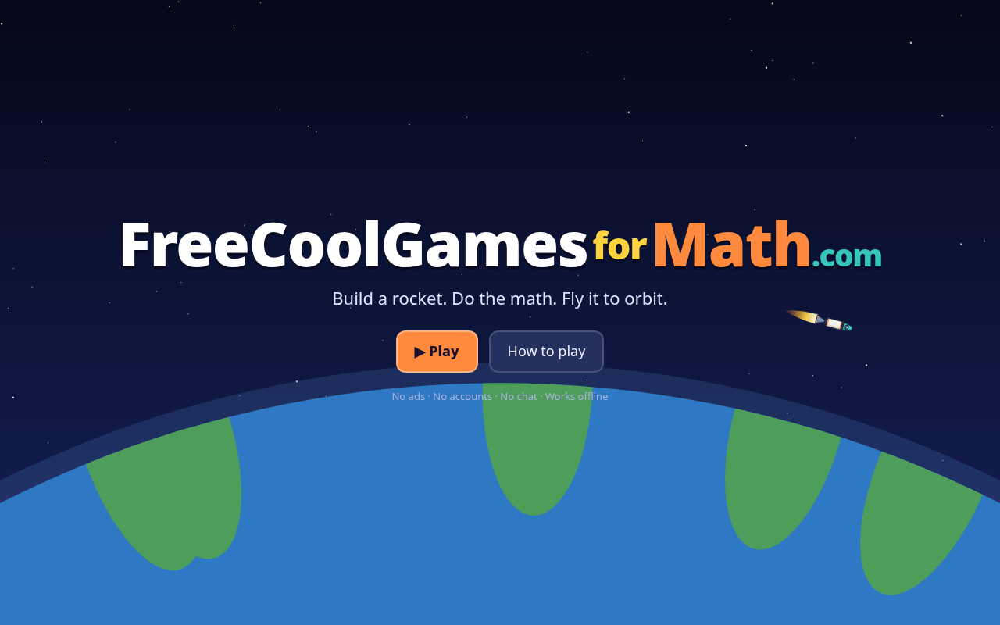
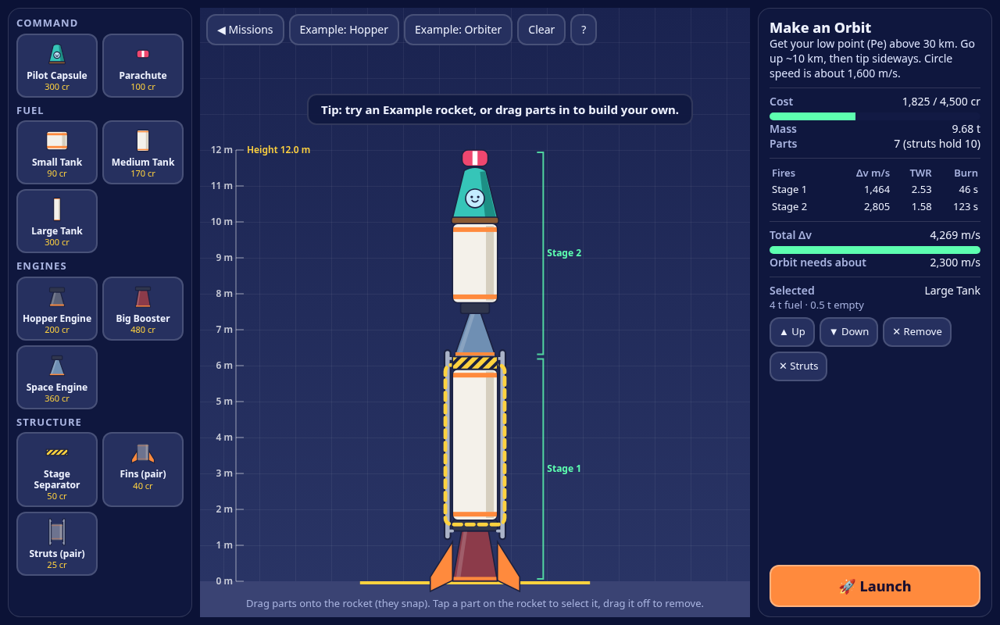
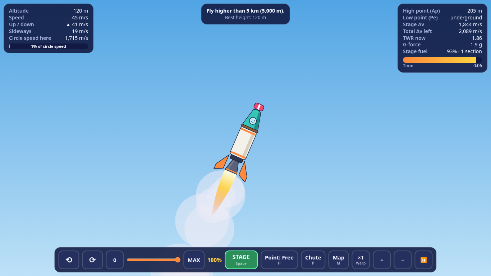

## License
MIT © 2026 Kampf Kaiser

### Screenshots (boost1)
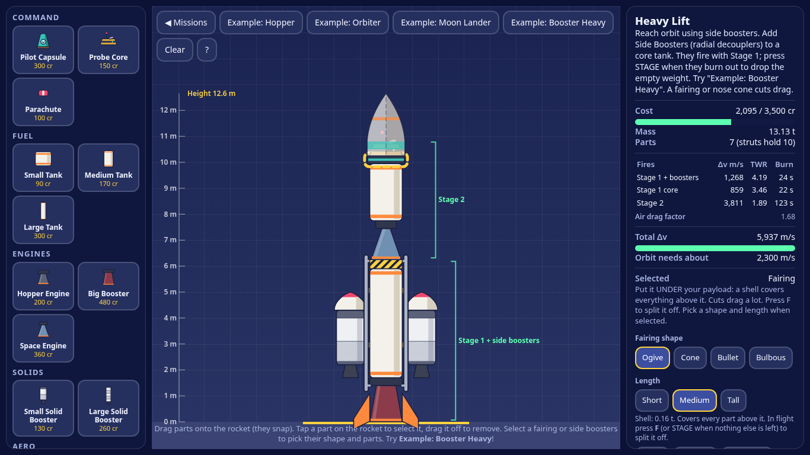
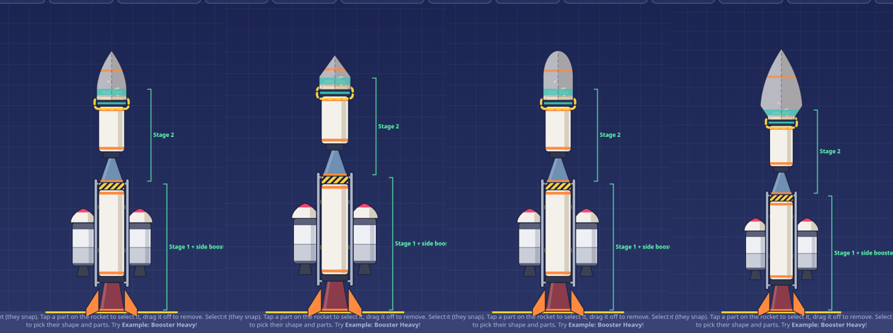
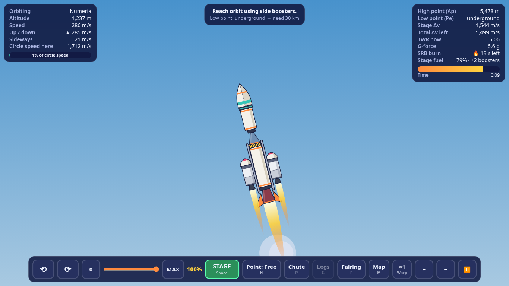
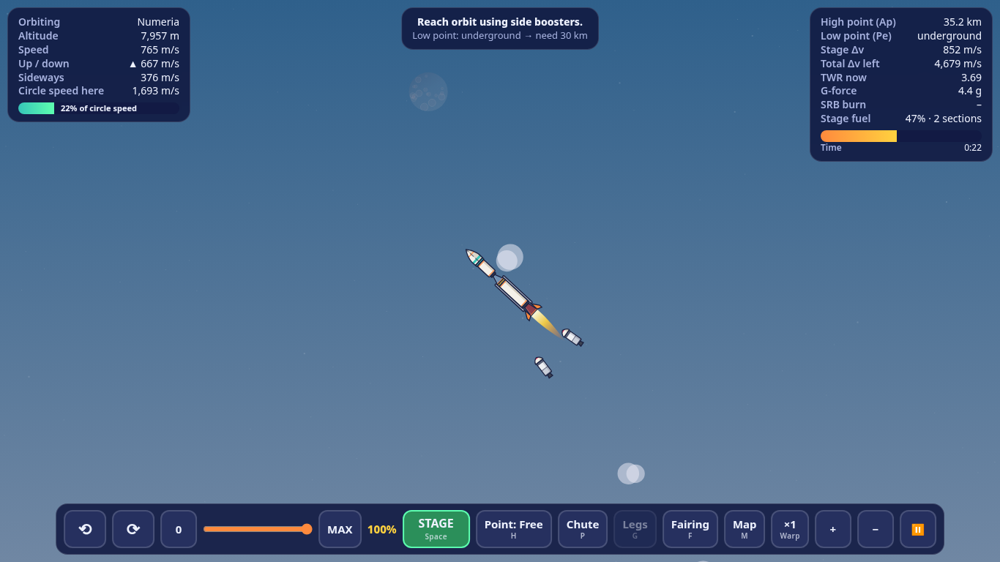
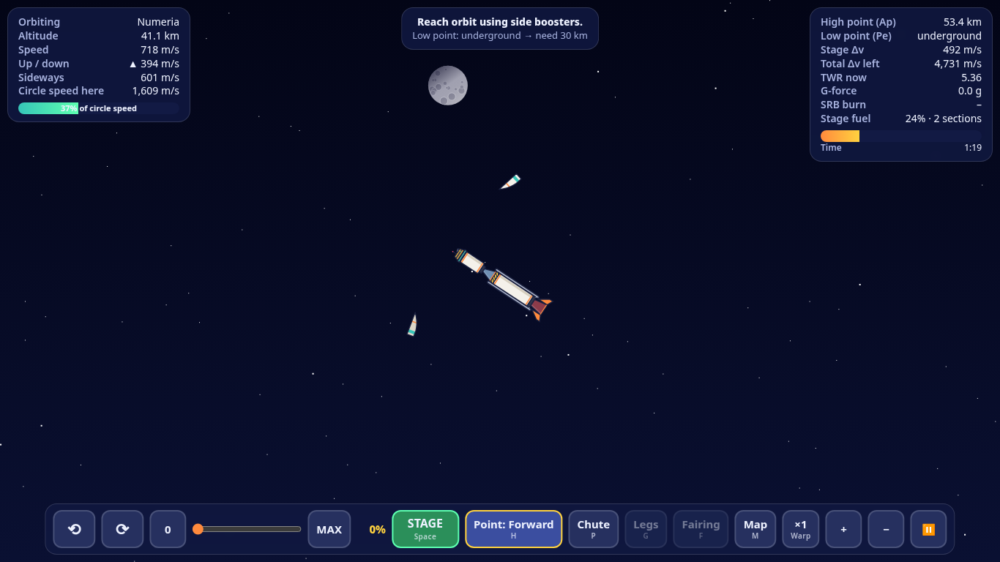

## Fleet update (fleet1): many craft in one world
- **Payload Separator** + **R / Release**: anything above it becomes its own craft. Dropped stages with a probe core or capsule become craft too; others become debris (max 30, cleaned up).
- New parts: **Antenna**, **Battery Pack**, **Solar Panels** (probe + antenna + solar = Satellite; command + engine + legs = Lander).
- Switch craft with **[ ]** or the **Vessels** list (**V**, tap ✎ to rename). The map shows every craft and its orbit. Inactive craft move on rails (Kepler orbits, SOI changes); landed craft stay put.
- **Sandbox World** / **Constellation** use a saved world (localStorage): **Leave in space**, launch again, old craft are still there. **Tracking** lists them (Fly / rename / remove, Reset world).
- New missions: Deploy a Satellite, Moon Lander Drop, Constellation, Sandbox World. Examples: Satellite Launcher, Lander Carrier.

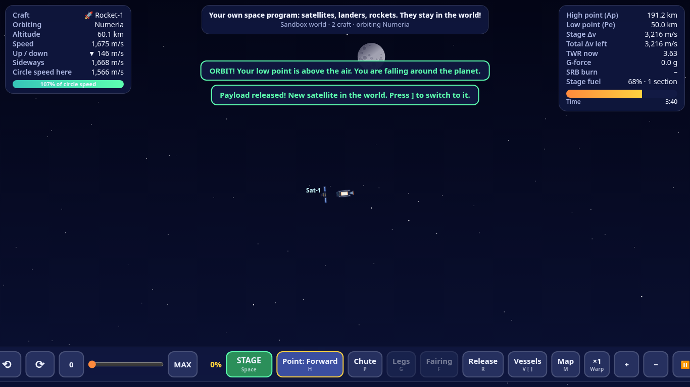 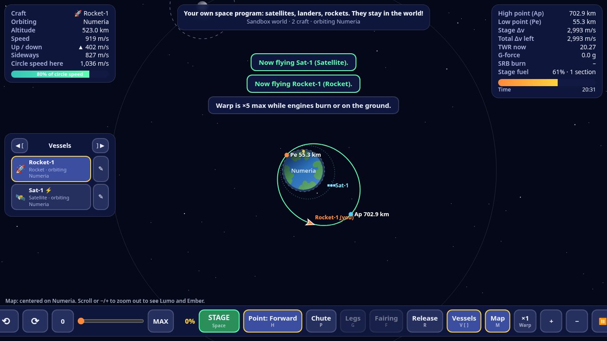 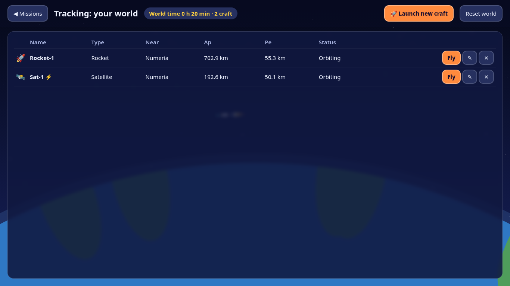

## Multiplayer (mp1)

Main menu → **👥 Multiplayer**. Peer-to-peer WebRTC through [PeerJS](https://peerjs.com) (loaded from unpkg, jsdelivr fallback, only when you open Multiplayer) and the free public PeerJS broker. No server of our own.

- **Host Game** gives a 5-character room code (PeerJS id `fcgm-<CODE>`). **Join Game** takes the code. Up to 6 pilots, each with a nickname and color.
- In flight every pilot's active craft shows in the sky (parts silhouette + name label) and on the map (colored marker + orbit). State goes out 10×/s; between updates it's moved along its orbit and smoothed.
- The host owns the shared clock. Only the host changes time warp, and warp only goes up when every flying pilot can warp safely (engines off, out of the air). Clients' clocks are pulled gently onto the host's, never jumped. Pausing doesn't stop time in multiplayer.
- Chat (lobby + in-flight panel, **Enter** to type, **T** hides the panel) with a light word filter and rate limit. Join/leave/timeout toasts. Clients try to rejoin 3 times if the host drops.
- **Race mode**: the host picks a mission, everyone goes to that hangar, finish times and costs go on a results board.
- Not connected = single-player exactly as before. Multiplayer flights use a fresh shared-clock world, not your saved Sandbox world.

Tests: `node tests/mp.test.js` (codes, filter). `FAKE=1 python3 tests/mp_e2e.py` runs two browser pages against a local server (`python3 -m http.server 8765`). FAKE=1 swaps PeerJS for a BroadcastChannel stand-in for sandboxes where WebRTC can't gather ICE candidates.

Screenshots: `docs/mp-menu.png`, `docs/mp-lobby.png`, `docs/mp-flight-two-players.png`, `docs/mp-flight-joiner-view.png`, `docs/mp-map-both.png`, `docs/mp-chat-in-flight.png`, `docs/mp-race-results.png`.
